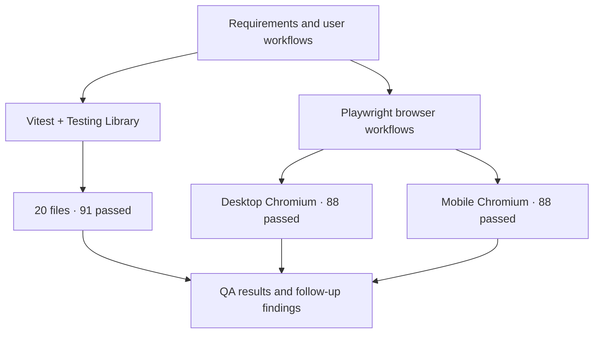

# Revision — QA Test Project

Revision is a browser-based study planner for organizing books and topics, scheduling reviews, and keeping notes and study progress. This repository includes a dedicated QA suite for checking the app's core behavior across component-level tests and real browser workflows.

## Latest QA run

Results below are from a local run on **20 November 2026**.

| Test layer | Command | Scope | Result |
| --- | --- | --- | --- |
| Unit and component | `npm test` | 20 test files | **91 passed, 0 failed** |
| Browser end-to-end | `npm run test:e2e` | 88 scenarios on desktop Chromium and mobile Chromium | **176 passed, 0 failed** |
| Combined executed tests | — | Unit/component plus both browser projects | **267 passed, 0 failed** |

The first sandboxed attempt to start Playwright was blocked because the environment denied binding the local Vite server (`listen EPERM` on `127.0.0.1:5183`). The same E2E command was then run with permission to start that local server and all 176 browser executions passed. The sandbox block was an environment issue, not a failed test.

`npm run lint` and `npm run build` were **not run** as part of this QA run. They are available project checks but are not included in the pass counts above.

## Test system at a glance



The browser suite runs each E2E scenario in both configured projects. That is why 88 distinct browser scenarios produce 176 test executions.

## What is covered

| Area | Current coverage |
| --- | --- |
| Navigation | Main destinations, dock state, keyboard activation, and drill-down/back flows |
| Home and scheduling | Focus card, topic ordering, schedule changes, date/time validation, and daily rollover |
| Library | Book/topic browsing, search, add/edit/delete, empty states, and storage recovery |
| Topic spaces | Notes, checklist, and board behavior at the component level; topic navigation in browser tests |
| Persistence | Local storage behavior, reload persistence, deletion cleanup, and corrupt or empty library storage |
| Accessibility checks | Selected keyboard, focus, accessible-name, semantic-role, sheet, and tab behaviors |
| Responsive behavior | Browser workflows on desktop Chromium and the configured Pixel 7 mobile Chromium profile |

The test files are organized by QA area:

```text
tests/
  accessibility/  Keyboard, focus, roles, sheets, and tabs
  calendar/       Calendar navigation and scheduling
  e2e/            Playwright workflows for Home, Library, and navigation
  insights/       Insights page behavior
  library/        Library, book/topic management, and search
  navigation/     Routing, dock, and drill-down behavior
  persistence/    Local storage and daily rollover behavior
  settings/       Settings behavior
  topic/          Topic page, notes, checklist, and board behavior
```

## Tests not covered or not verified

These are coverage limits, not reported product defects:

- **Other browsers:** Firefox, Safari/WebKit, and non-Chromium browser engines are not configured in the current Playwright projects.
- **Real devices:** The mobile suite uses Playwright's Pixel 7 device profile; it does not replace checks on physical phones or tablets.
- **Assistive technology:** Automated accessibility assertions are present, but a full screen-reader session and formal WCAG audit were not performed.
- **Performance and load:** No performance, stress, or large-library scalability suite is configured or included in this run.
- **Security:** No dedicated security scan, penetration test, or dependency audit was run.
- **Backend/API integration:** The app currently stores data in browser `localStorage`; this run does not validate a remote API or database service.
- **Lint and production build:** `npm run lint` and `npm run build` were not run on the date above.
- **CI execution:** The results above are from a local run. No CI workflow result is included here.

## Run the QA checks

Requirements: Node.js (an active LTS version is recommended) and npm.

```bash
npm install
npm test
npm run test:e2e
```

The Playwright configuration starts Vite on `127.0.0.1:5183` and runs desktop Chromium and mobile Chromium. Install Playwright's browser binaries in a fresh environment if needed:

```bash
npx playwright install chromium
```

Additional project checks:

```bash
npm run lint
npm run build
npm run test:all
```

`npm run test:all` runs the Vitest suite followed by Playwright. The Playwright HTML report is configured to be written to `playwright-report/`; test result artifacts are ignored by Git.

## QA reporting standard

When reporting a new run, include:

- The date, revision/build tested, environment, and browser/device projects.
- Exact commands or manual workflows performed.
- Passed, failed, skipped, and blocked counts separately.
- Reproduction steps and expected-versus-actual behavior for each defect.
- Important coverage gaps and checks that were not run.

Do not describe an unrun check as passing. Keep defects separate from test-environment problems and test-only issues.

## Application notes

The app has no backend service or account sync configured. Study data is stored in the current browser's `localStorage`; clearing that storage removes the saved data. The initial sample library is shown when there is no saved library.

Useful commands:

| Command | Purpose |
| --- | --- |
| `npm run dev` | Start the local Vite development server. |
| `npm run preview` | Preview the production build locally after `npm run build`. |
| `npm test` | Run Vitest once. |
| `npm run test:e2e` | Run Playwright on desktop and mobile Chromium. |
| `npm run test:all` | Run Vitest and then Playwright. |
